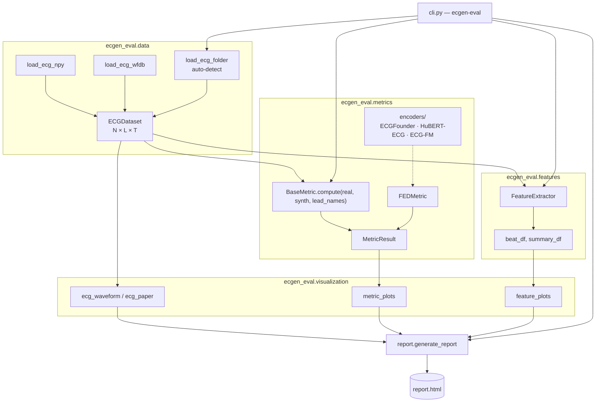

# Architecture

## Data flow



## Package layout

```text
ecgen_eval/
├── __init__.py            exports loaders + AVAILABLE_METRICS
├── cli.py                 Click entry point: eval, features, visualize, list-metrics
├── data/
│   ├── dataset.py         ECGDataset, LEADS_12, LEADS_8
│   └── loader.py          NumPy / WFDB / CSV loaders
├── metrics/
│   ├── __init__.py        AVAILABLE_METRICS registry
│   ├── base.py            BaseMetric, MetricResult
│   ├── _frechet_utils.py  shared Fréchet distance math (fd, fed)
│   ├── encoders/          foundation-model adapters for FED
│   └── <metric>.py        one module per metric
├── features/
│   ├── extractor.py       FeatureExtractor, extract_features
│   ├── qrs_detection.py   R-peaks + delineation (NeuroKit2 / SciPy fallback)
│   ├── interval_features.py
│   ├── amplitude_features.py
│   ├── hrv_features.py
│   └── utils.py
├── visualization/
│   ├── ecg_paper.py       graph-paper figure factory, colour palette
│   ├── ecg_waveform.py    real vs synthetic waveform plots
│   ├── metric_plots.py    bar, violin, PSD overlay, radar
│   └── feature_plots.py   2D/3D clinical feature plots
└── report/
    └── html_report.py     generate_report()
```

## Design conventions

- **One array shape everywhere.** Signals are `(N, L, T)`. Metrics receive raw arrays
  (`dataset.data`), not `ECGDataset` objects, so they can be used on any NumPy data.
- **Unpaired comparison.** Metrics compare sets; `real` and `synth` may have different `N`
  but must have the same `L`.
- **Uniform result type.** Every metric returns a `MetricResult` with `score`,
  `per_lead_scores`, `extra` and `higher_is_better`. Reports and plots rely only on this
  interface.
- **Registry.** Metrics are discovered through `AVAILABLE_METRICS`; the CLI's `--metrics`
  choices and `list-metrics` are generated from it.
- **Optional dependencies are imported lazily** inside functions, with an `ImportError`
  fallback or an explicit install hint. Importing `ecgen_eval` never requires SciPy, WFDB,
  NeuroKit2 or PyTorch.
- **Deterministic by default.** Subsampling and random pairing use fixed seeds.
